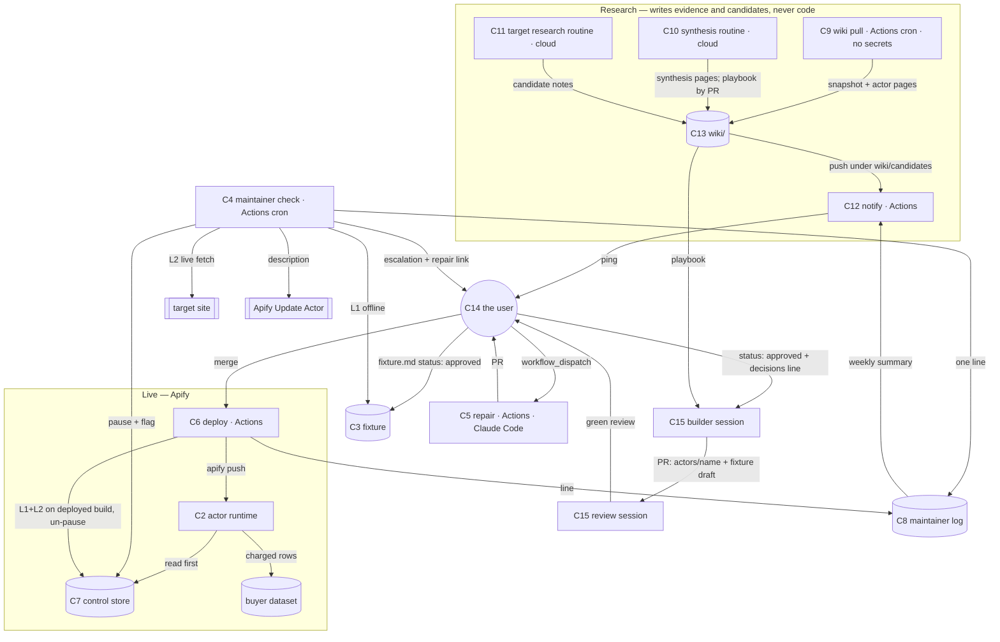

# Architecture — actor-foundry

Written 2026-10-18 by `/architect` from the frozen brief, the living plan and the rulings of the
same day. Decisions live in `context/adr/`; this file holds the forces, the boundaries, the data
shapes, the failure modes, the verification posture and the handoff `blueprint` consumes. No
application code exists yet; the building happens in a separate session (user ruling).

## Forces

**Hard constraints**
- Every actor: pay-per-event, limited permissions, charged through `push_data`, state on
  `PERSIST_STATE`, open source, priced under the incumbent, never below platform cost.
- The maintainer never publishes, never changes a price, never touches another actor's
  fixture, never exceeds 1 compute unit per run; an actor it cannot repair is paused with a
  status message, never unpublished.
- No public listing without a dated ruling in `context/decisions.md` and a PR that passed an
  adversarial review in a non-authoring session (`/code-review high` with the candidate note,
  fixture and claimed checklist IDs as intent; `/red-team` before publish and on `.github/`).
- Secrets live in GitHub Actions repository secrets and the local `.env`, nowhere else; never
  on the Grok Bot computer. A plaintext `.env` posture is adequate while every secret is ours,
  cheap and revocable in a minute (vault `knowledge/when-plaintext-env-stops-being-adequate.md`).
- The only unattended runner is GitHub Actions cron; in-app scheduled tasks fire only while
  the app is open (vault, measured). Cloud routines run memory-blind and load no `CLAUDE.md`.
- Unattended Claude Code on the subscription is documented for CI but limited; keep it rare.
- The operator has 6–8 hours a week. Milestone 1 slips on 2026-11-15; the kill criterion is
  no paid run by a stranger by 2027-01-31.

**Scale.** Two actors by December; tens of buyer runs a day at first; one maintainer check per
actor per day; one wiki pull a week over ~91k Store actors (ranked locally); one synthesis a
month; up to five candidate notes a week.

**Existing stack.** Python 3.12, `uv`, `pytest`, `ruff`, Apify Python SDK, Crawlee for
Python, Apify CLI, GitHub (private repo `wrighty321/actor-foundry`), Telegram bot, Obsidian
on `wiki/`, Claude Code (builder, reviewer, repair), Claude cloud routines (synthesis, target
research). Bare `python` on this machine resolves to an unrelated venv — every command uses
`uv run`.

**Volatile vs stable** (the volatile parts get boundaries around them)
- Volatile: target-site markup (daily); the fetch layer per site (proxies, browser or not);
  Apify eligibility and pricing rules; model IDs and the Claude Code CLI surface; the
  synthesis and target-research prompts; the candidate scoring weights.
- Stable: the fixture format and pass definition (ADR 002); the control record schema
  (ADR 003); the charging contract (ADR 008); the maintainer log line (ADR 005); the wiki's
  layout and evidence grades; the human gates.

## Components

| # | Component | Responsibility (one line) | Runs where | Writes | Reads | Secrets |
|---|---|---|---|---|---|---|
| C1 | `foundry` package | Shared plumbing: control read/write, charged push with limit stop, fixture L1/L2 runner, Store client, Telegram sender, CLI | library | — | — | — |
| C2 | Actor runtime `actors/<name>/src/` | Read control record → input → fetch → `extract` → charged push; persist on `PERSIST_STATE`; fail loudly | Apify | default dataset, KV state | control record, input | none (Apify injects its own token) |
| C3 | Fixture `actors/<name>/fixture/` | The user-owned definition of "working": saved sources, expected rows, anchors, approval | data in repo | — | — | — |
| C4 | Maintainer check `maintainer-check.yml` → `foundry check` | Daily L1+L2 per actor; on fail pause, flag, escalate; always log one line | Actions cron | control record, actor `description`, `maintainer/log/`, Telegram | fixture, live pages | `APIFY_TOKEN`, Telegram |
| C5 | Maintainer repair `maintainer-repair.yml` | On manual trigger, run Claude Code against the failing fixture and open a PR; never deploy | Actions `workflow_dispatch` | a PR | repo, fixture result | `CLAUDE_CODE_OAUTH_TOKEN` (+ GitHub token) |
| C6 | Deploy `deploy.yml` → `foundry deploy` | On merge to `main` under `actors/**`: tests, vendor wheel, `apify push`, L1+L2 on the deployed build, un-pause, log | Actions on push | Apify build, control record, log | repo | `APIFY_TOKEN`, Telegram |
| C7 | Control store `actor-foundry-control` | One record per actor: pause flag, reason, repair id, original description | Apify named KV store | — | — | — |
| C8 | Maintainer log `maintainer/log/<actor>.md` | Append-only, one line per check or deploy; the 7/30-day proof | repo | — | — | — |
| C9 | Wiki pull `wiki-pull.yml` → `foundry pull` | Weekly public Store pull: snapshot, actor pages, local ranking, weak sample | Actions cron | `wiki/evidence/**` | Store API (public) | none |
| C10 | Synthesis routine (`routines/wiki-synthesis.md`) | Monthly, after two snapshots: fill `wiki/synthesis/`, propose playbook PRs | Claude cloud routine | `wiki/synthesis/**`, PRs to `wiki/playbook/**` | snapshots, actor pages, first-party | none |
| C11 | Target research routine (`routines/target-research.md`) | Weekly: find, score and write up to five candidate notes | Claude cloud routine | `wiki/candidates/<slug>.md` | `store-gaps.md`, the web | none |
| C12 | Notify `notify.yml` → `foundry notify` | On push under `wiki/candidates/**`: one Telegram message per run; weekly summary cron | Actions | Telegram | candidate notes, `maintainer/log/`, `maintainer/analytics/` | Telegram |
| C13 | Wiki (Obsidian vault on `wiki/`) | Evidence → synthesis → playbook; candidates; first-party; the user's review surface | files | — | — | — |
| C14 | Human gates | Candidate `status`, fixture `status`, PR merge, publish ruling, `decisions.md` | the user | `wiki/candidates`, `fixture.md`, GitHub, `decisions.md` | Telegram, Obsidian, GitHub | — |
| C15 | Builder and review sessions | Build from an approved note and fixture; review in a non-authoring session | Claude Code, interactive | `actors/<name>/**` by PR | `wiki/playbook/`, note, fixture | local `.env` only |

## Boundaries



Boundary test applied: a target site changing its markup touches `extract.py`, the fixture's
anchors and nothing else; a change to the pause semantics touches `foundry.control` and the
first ten lines of every `main.py` and nothing else; a prompt change touches one file in
`routines/` and nothing else.

## Interfaces and data shapes

**Control record** — `actor-foundry-control` KV store, key `<actor-name>` (ADR 003)
```json
{ "paused": false, "since": null, "reason": null, "repair_id": null,
  "original_description": null, "last_check": "2026-11-02T06:10:00Z" }
```

**Fixture** — `actors/<name>/fixture/fixture.md` frontmatter (ADR 002)
```yaml
status: draft            # draft | approved — set to approved only by the user
approved_on:             # YYYY-MM-DD
source_urls: [https://…/page-1, https://…/page-2]
fetched_on: 2026-11-01
live_pages: [https://…/page-1]
min_rows: 20
fields: [{name: company, type: str}, {name: title, type: str}, {name: url, type: url}]
anchors:
  - {field: company, kind: exact, value: "Acme Ltd", page: 1}
  - {field: url, kind: pattern, value: "^https://example\\.com/profile/\\d+$", page: 1}
  - {field: title, kind: present, page: 1}
```
`expected.jsonl`: one row per line, keys exactly `fields`. `source/`: one saved response per
`source_urls` entry, named by index.

**Row** — the actor's output and the charged unit (ADR 008): a flat JSON object whose keys are
exactly the fixture's `fields`; a row missing any field is not pushed and is counted.

**Maintainer log line** — `maintainer/log/<actor>.md` (ADR 005)
```
2026-11-02 | L1 pass | L2 fail | anchors: company@1 exact | action: paused, escalated | CU 0.02 | run <url>
2026-11-03 | deploy a1b2c3d by wrighty321 | L1 pass | L2 pass | action: unpaused | CU 0.03 | run <url>
```

**Telegram messages** (plain text, send-only): escalation = actor, structural cause, pause
state, repair-workflow link; repair request = actor, PR link, L1/L2 on branch, "Merge to
deploy; close to reject"; candidate ping = one line per new note: slug, pitch, total; weekly
summary = per actor: runs, repairs, escalations, log-day count, profit (manual reading or
"not read this week").

**Snapshot** — `wiki/evidence/snapshots/<date>.json`: `{ "pulled_at", "store_total",
"sample": {"top300": [...ids], "category_top20": {cat: [...]}, "weak": [...]}, "actors": {id:
<store item + act fields + build readme/inputSchema hash>} }`. The pull writes it only when the
page count reconciles with `store_total`; a partial pull writes nothing.

**Actor page** and **candidate note** frontmatter: as in `wiki/README.md` and
`wiki/playbook/candidate-card.md`.

**`foundry` CLI** (ADR 006): `check <actor>`, `pause <actor> --reason`, `unpause <actor>`,
`deploy <actor>`, `pull`, `notify candidates|summary`. Every subcommand exits non-zero on any
unverified write (a pause that did not read back is a failure).

**Workflow triggers.** `maintainer-check`: cron daily per actor. `maintainer-repair`:
`workflow_dispatch` with `actor`. `deploy`: push to `main`, paths `actors/**`. `wiki-pull`: cron
weekly. `notify`: push to `main`, paths `wiki/candidates/**`; plus a weekly cron for the
summary. Log commits touch `maintainer/**` only and trigger nothing.

## Failure modes and designed behaviour

| Component | Break | Designed behaviour |
|---|---|---|
| C2 actor | Control store unreadable | 3 retries with backoff, then `Actor.fail(exit_code=11, …)`; never run unchecked |
| C2 actor | Target blocks (403, challenge) | Fail with status "Blocked by target (HTTP 403) on <url>; nothing charged"; no rows pushed |
| C2 actor | Buyer spending limit reached | `ChargeResult` seen → persist state, exit cleanly with the count; no further charge |
| C2 actor | Migration mid-run | `PERSIST_STATE` handler saved progress; resume from it; no row charged twice |
| C2 actor | `extract` yields zero complete rows on a live run | Fail loudly: "0 complete rows — the site may have changed"; never a zero-row success |
| C4 check | Live fetch errors (network, 5xx) rather than mismatches | Retry twice in-job; escalate as `fetch-error` **without pausing**; pause only on content mismatch, or on fetch-error two days running |
| C4 check | Pause write fails | 3 retries; then escalate "COULD NOT PAUSE <actor>" at top priority; log it |
| C4 check | Telegram send fails | Log line still written with `escalation_sent: false`; summary flags it; next run retries |
| C4 check | Cron missed (runner outage) | The log has a gap; the weekly summary counts log days and names any missing date |
| C5 repair | Claude Code hits `--max-turns` or job timeout | No PR; escalation stands; log line `repair failed: timeout` |
| C5 repair | PR's L1/L2 red on branch | PR check red; Telegram says so; nothing deploys |
| C6 deploy | `apify push` fails | Previous build stays live; actor stays paused if it was; Telegram "deploy failed" |
| C6 deploy | L2 fails on the deployed build | Stay paused; Telegram; log line |
| C6 deploy | Listing-visible change with no ruling line | Deploy step fails with the message naming the missing `decisions.md` line |
| C7 control store | Outage | Every actor fails closed (above); check escalates once per actor |
| C9 pull | Rate limit / paging stops early | Nothing written: the snapshot requires page count × page size ≥ `store_total`; the job fails visibly |
| C10/C11 routines | Cannot reach the repo | No output; fallback `/wiki-refresh` by hand; plan risk row carries it |
| C10/C11 routines | Misread prompt, write wrong pages | Damage bounded: `wiki/playbook/` is PR-only; planted-flaw check (below) before trusting output |
| C12 notify | Telegram down | Actions job fails visibly; re-run by hand |
| C13 wiki | Stale local copy | Obsidian Git plugin pulls on open; never Obsidian Sync on `wiki/` (vault: Sync skips `.git`) |
| C14 gates | Note `approved` but no `decisions.md` line | B1 stops the build; the next session records both before anything proceeds |

## Verification posture

- **Test runner:** `uv run pytest` at the workspace root; `uv run ruff check` and `ruff format
  --check` beside it. Both run on every PR via Actions.
- **Durable tests (committed):** `foundry.charge` limit path against a fake `Actor`;
  `foundry.control` retry and fail-closed against a fake KV; `foundry.fixture` L1 for every
  actor's `source/` → `expected.jsonl`, and L2's assertions against saved responses stood in
  as "live"; `foundry.store` paging, local ranking and the `store_total` reconciliation against
  a saved Store page; log-line formatting and parsing; summary generation from a fixture log.
  Each actor's `extract` is covered by its L1.
- **Held once on the private stub, not by tests** (recorded in `build-plan.md` with evidence):
  Docker context for the vendored wheel; kill-switch read before any charge; description PUT
  and read-back; synthetic-event double-charge check; `workflow_dispatch` runs of each workflow.
- **LLM steps** (C10, C11): planted-flaw checks (vault
  `knowledge/evaluate-llm-output-by-planting-known-flaws.md`) — a committed test snapshot with
  known weak actors and one known gap must surface them in the synthesis; a planted candidate
  set with one login-walled and one terms-flagged site must be excluded and flagged
  respectively. Run by hand before trusting a routine and after any prompt change.
- **Third-party flows, one real run each:** Telegram delivery, merge → deploy → un-pause,
  cloud routine commit.
- **Cannot be held:** Store quality-score effects of paused failures, buyer behaviour, Actions
  minute usage before it is measured.

## Handoff for `blueprint`

**Components in dependency order**
1. C1 `foundry` package (control, charge, fixture, store, telegram, cli) — everything else
   imports it.
2. C3 fixture format + C2 actor template (`actors/_template/`) — the stub actor is the first
   instance.
3. C7 control store (created once, by hand or `foundry init`).
4. C4 maintainer check workflow + C8 log.
5. C6 deploy workflow (with the listing-change gate).
6. C5 repair workflow.
7. C12 notify (escalation already in C4; candidate ping and weekly summary here).
8. C9 wiki pull.
9. C11 target research routine + `routines/target-research.md` (milestone 1c).
10. C10 synthesis routine + `routines/wiki-synthesis.md` + `/wiki-refresh` skill (milestone 1d).

**ADRs:** 001 runner topology · 002 fixture semantics and format · 003 pause mechanism ·
004 approval and deployment · 005 maintainer state and log · 006 repo layout and shared
package · 007 research-agent runners · 008 pricing events. All eight **accepted by the user on
2026-10-18**; a reversal is a new ADR marked `Supersedes NNN`, never an edit.

**Failure modes and verification:** the two sections above, as written.

**Open questions the design leaves on purpose**
- Whether a buyer can be spared the $0.00005 start fee on a paused attempt — the event is
  platform-charged; accepted unless a cheaper honest route appears.
- The Docker build context for `apify push` (assumed the actor directory) — verified on the
  stub.
- Whether cloud routines can commit to the private repo — verified by 1c's first run.
- Branch protection on `main` versus bot log commits — no protection for now (ADR 004).
- A failure-class taxonomy for the trust ladder — written from the first real escalations,
  not before.
- Profit per actor stays a manual weekly reading until an analytics API is found.
- Whether `description` prefixes affect Store ranking — unknown; watched after the first pause.
