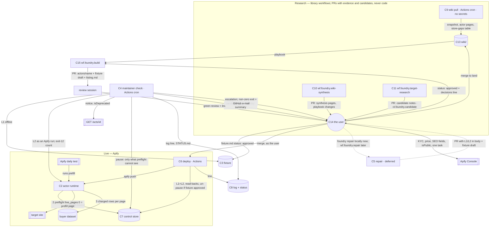

# Architecture — actor-foundry

Written 2026-10-18 by `/architect` from the frozen brief, the living plan and the rulings of the
same day; amended the same day after an independent Kun-lens review (ADRs 009–013), and again
after the quality-score pass with its own Kun-lens review and the user's instruction to fit the
personal OS (ADRs 014–016). Decisions live in `context/adr/`; this file holds the forces, the
boundaries, the data shapes, the failure modes, the verification posture and the handoff
`blueprint` consumes. No application code exists yet; the building happens in a separate
session (user ruling).

## Forces

**Hard constraints**
- Every actor: pay-per-event, limited permissions, charged through `push_data`, state on
  `PERSIST_STATE`, open source, priced under the incumbent, never below platform cost.
- The maintainer never publishes, never changes a price, never deletes or deprecates an actor,
  never touches another actor's fixture, never exceeds 1 compute unit per run; an actor it
  cannot repair is paused with a status message, never unpublished.
- No public listing without a dated ruling in `context/decisions.md`, a PR that passed an
  adversarial review in a non-authoring session (`/code-review high`; `/red-team` before publish
  and on `.github/`, `library/`), `foundry lint` green, and KYC passed (ADR 015).
- Secrets live in GitHub Actions repository secrets and the local `.env`, inventoried once in
  `.env.example`; never on the Grok Bot computer, never in a cloud routine or an agent body.
- The only unattended runner today is GitHub Actions cron (in-app scheduled tasks fire only
  while the app is open — vault, measured; `schedule` runs can be delayed or dropped at the top
  of the hour — GitHub docs). Cloud routines run memory-blind and load no `CLAUDE.md`. The
  personal OS's shell and registry do not exist before 2026-11-11 (ADR 016).
- Apify's daily test runs the prefill input and wants `Succeeded` with a non-empty dataset
  within 5 minutes; 3 failed days → `under maintenance`, +14 → notice, +14 → `deprecated`; a
  target-site break that passes most tests in the next 7 days heals on its own unless the actor
  is paused. Default Store search excludes actors from developers without KYC. Congruency across
  title, description, README, input schema and dataset schema is scored (ADR 014, 015).
- Apify scoped tokens cannot modify actors but can be limited to named resources (reviewer's
  read; **assumed** until the first scoped token exists). The Store list envelope's `count`
  overstates the items it returns (observed).
- Every model-run piece follows the personal OS's capability shape (ADR 016): a workflow
  directory with wiring as data, nineteen-field agent bodies under a token budget, contracts,
  a lens, tests the agent did not write, a finisher; agents never write their own files.
- The operator has 6–8 hours a week. Milestone 1 slips on 2026-11-15; the kill criterion is
  no paid run by a stranger by 2027-01-31.

**Scale.** Two actors by December; tens of buyer runs a day at first; one maintainer check per
actor per day; one wiki pull a week over ~91k Store actors (ranked locally); one synthesis a
month after two snapshots; at most two candidate notes per on-demand research run until actor
#1 is approved.

**Existing stack.** Python 3.12, `uv`, `pytest`, `ruff`, Apify Python SDK, Crawlee for
Python, Apify CLI, GitHub (private repo `wrighty321/actor-foundry`), Telegram bot, Obsidian on
`wiki/`, Claude Code (builder, reviewer, local repair, interim sequencer), Claude cloud
routines. Bare `python` on this machine resolves to an unrelated venv — every command uses
`uv run`.

**Volatile vs stable**
- Volatile: target-site markup (daily); the fetch layer per site; Apify eligibility, pricing
  and scoring rules; model IDs and the Claude Code CLI surface; agent bodies' know-how; the
  candidate scoring weights; which runner hosts a workflow (interim today, the OS later).
- Stable: the fixture format and pass definition (ADR 002, 009, 010); the control record
  (ADR 012); the charging contract (ADR 008, 009); the log line and status page (ADR 005, 013,
  015); the wiki's layout and evidence grades; the workflow directory shape and contracts
  (ADR 016); the human gates.

## Components

| # | Component | Responsibility (one line) | Runs where | Writes | Reads | Secrets (see `.env.example`) |
|---|---|---|---|---|---|---|
| C1 | `foundry` package = functions `fn.foundry.*@1` + CLI | control read/write, preflight, page-buffered charged push, fixture L1/L2, **lint**, Store client with reconciliation and the store-gaps table, Telegram, status page, deploy, interim sequencer `run-workflow` | library | — | — | — |
| C2 | Actor runtime `actors/<name>/src/` | read control record → **preflight `live_pages[0]`** (also the schema's `prefill`/`default`) → input → fetch → `extract` → charged push per page; `PERSIST_STATE`; exit 10/11/12 | Apify | default dataset, KV state | control record, input | none (Apify injects the run token) |
| C3 | Fixture `actors/<name>/fixture/` | The user-owned definition of "working": saved sources, expected rows, anchors, `min_complete_share`, approval; the source of the listing vocabulary | data in repo | — | — | — |
| C4 | Maintainer check `maintainer-check.yml` → `fn check` | Daily per actor: L1 offline, L2 as an Apify run, exit-12 count; **pause only for what the preflight cannot see** (ADR 015 §1); read Apify's `notice`/`isDeprecated`; one log line; regenerate `STATUS.md`; candidate pings; Monday summary with Console Monday due; exit non-zero when a human is needed | Actions cron, off the hour | control record, `maintainer/log/`, `maintainer/STATUS.md`, Telegram | fixture, runs list, `/acts/{id}`, candidate PRs | `APIFY_TOKEN_SCOPED`, Telegram pair |
| C5 | Repair = `library/wf.foundry.repair/` | **Not built until the first real escalation**; `foundry repair <actor>` runs the brief locally meanwhile. When built: reproducer (fixture result) → implementer → fixer (two rounds) → finisher; L1/L2 in-job into the PR body; Telegram line; a PR with the fixture draft; never deploys | local now; Actions `workflow_dispatch` later | a PR | repo, fixture result | later: `CLAUDE_CODE_OAUTH_TOKEN`, Telegram pair |
| C6 | Deploy `deploy.yml` → `fn deploy` | On the **user's** push to `main` under `actors/**`: tests, lint, vendor wheel, `apify push`, L1+L2 on the deployed build, read back price vs README, permission level, `notice`; un-pause only if `fixture.md` is `approved` on or after the repair; `listing-change` gate (`#<PR>`); never sends `name`, `isPublic`, `isDeprecated`, `pricingInfos`, SEO fields | Actions on push, `if: github.actor == 'wrighty321'` | Apify build, control record, log | repo, `fixture.md`, `listing.md`, `pricingInfos` | `APIFY_TOKEN`, Telegram pair |
| C7 | Control store `actor-foundry-control` | One record per actor: pause flag, reason, repair id (informational), last check | Apify named KV store | — | — | — |
| C8 | Log and status `maintainer/log/<actor>.md`, `maintainer/STATUS.md` | Append-only lines (the 7/30-day proof); a regenerated status page with Apify's `notice` beside ours and everything awaiting a human | repo | — | — | — |
| C9 | Wiki pull `wiki-pull.yml` → `fn pull` | Weekly public Store pull with `includeUnrunnableActors=true`: page, dedupe, reconcile on unique ids, record query parameters, `badge`, deprecated actors by id diff → `/acts/{id}`; snapshot, actor pages, weak sample, **store-gaps table** | Actions cron | `wiki/evidence/**`, `wiki/synthesis/store-gaps.md` (table) | Store API (public), previous snapshot | none |
| C10 | `library/wf.foundry.wiki-synthesis/` | Monthly after two snapshots: reader → extractor → writer → finisher; synthesis pages, prose grades on store-gaps, playbook proposals — **by pull request** | interim sequencer on a cloud routine; the OS later | PRs | snapshots, actor pages, first-party | none |
| C11 | `library/wf.foundry.target-research/` | On demand (cap 2) until actor #1 is approved, then weekly (cap 5): reader → scout → writer → finisher; candidate notes validated against `ct.foundry.candidate@1` — **by pull request** | interim sequencer on a cloud routine or local; the OS later | PRs | `store-gaps.md`, snapshot, the web | none |
| C12 | *(retired)* | Notifications merged into C4 (ADR 013) | — | — | — | — |
| C13 | Wiki (Obsidian vault on `wiki/`) | Evidence → synthesis → playbook (incl. the publish runbook); candidates; first-party (Console Monday rows); the user's review surface | files | — | — | — |
| C14 | Human gates | Merge candidate PRs; set candidate `status`; set fixture `status` (on the PR branch after a repair); merge repair PRs; KYC; publish runbook (price, SEO fields, categories, `isPublic`, one task after the first clean test); Console Monday; `decisions.md` | the user | `wiki/candidates`, `fixture.md`, `listing.md`, GitHub, Console, `decisions.md`, `first-party/` | Telegram, GitHub, Obsidian, `STATUS.md`, Console | — |
| C15 | `library/wf.foundry.build/` + review session | Build from an approved note (named sections only, B20) and the user-owned fixture: scout → implementer → docs → finisher; acceptance is the fixture; reviewed in a non-authoring session | Claude Code (interim sequencer) | `actors/<name>/**` by PR | playbook, note, fixture | local `.env` only |
| C16 | OS fit: `library/`, `library/contracts/`, `.os/project.yaml`, `.os/tools.yaml` | The shape the OS registers later and blueprint builds now: workflow directories, nineteen-field bodies, JSON-schema contracts, the project truth, the allowed command surfaces | files | — | — | — |

## Boundaries



Boundary test applied: a target site changing its markup touches `extract.py`, the fixture (a
new draft the user approves) and nothing else; a change to the pause semantics touches
`foundry.control`, the check's pause classes and the first lines of every `main.py`; a prompt
change touches one body file in one workflow directory; a change to who may deploy touches one
ruleset and one `if:` line; a change of runner (interim → OS) touches no workflow directory.

## Interfaces and data shapes

**Control record** — `actor-foundry-control`, key `<actor-name>` (ADR 012; `ct.foundry.control@1`)
```json
{ "paused": false, "since": null, "reason": null, "repair_id": null,
  "last_check": "2026-11-02T06:23:00Z" }
```

**Fixture** — `actors/<name>/fixture/fixture.md` frontmatter (ADR 002, 009, 010, 014; `ct.foundry.fixture@1`)
```yaml
status: draft            # draft | approved — set to approved only by the user, in their own commit
approved_on:             # YYYY-MM-DD; un-pause after a repair needs this ≥ the repair commit date
source_urls: [https://…/page-1, https://…/page-2]
fetched_on: 2026-11-01
live_pages: [https://…/page-1]      # [0] is the preflight page AND the input schema's prefill/default start URL
min_rows: 20                        # also the prefill/default maxItems
min_complete_share: 0.9
fields: [{name: company, type: str}, {name: title, type: str}, {name: url, type: url}]
anchors:
  - {id: company@1, field: company, kind: exact, value: "Acme Ltd", page: 1}
  - {id: url@1, field: url, kind: pattern, value: "^https://example\\.com/profile/\\d+$", page: 1}
  - {id: title@1, field: title, kind: present, page: 1}
```
Generated from `fields`: `.actor/dataset_schema.json` (view `overview`). Linted against
`fields`: the README's Output example, the input schema's descriptions and prefill/default.

**Listing record** — `actors/<name>/listing.md` frontmatter (ADR 014 §4; `ct.foundry.listing@1`)
```yaml
title: "Example Directory Scraper"      # 40–50 chars, {Site} {Service} Scraper
slug: example-directory-scraper         # fixed once published_on is set
description: "…"                        # ≤ 300 chars
seo_title: "…"                          # ≤ 60
seo_description: "…"                    # 145–155
categories: [LEAD_GENERATION]
published_on:                           # set by the user at publish
kyc_passed_on:                          # publish precondition
```

**Row, exit codes, maintainer log line, status page, Telegram messages, snapshot** — as ADR
009, 012, 005, 013 and the previous version of this file, with these additions:
- log line gains `notice: NONE|UNDER_MAINTENANCE` and the pause class or `escalated
  (preflight guards)`;
- `STATUS.md` gains a `notice` column and the list `candidate PRs awaiting merge`, `fixtures
  awaiting approval`, `Console Monday due`;
- snapshot header gains `query: {sortBy, limit, includeUnrunnableActors}` and the pull records
  `badge`, `isDeprecated` (by id diff → `/acts/{id}`), `createdAt`, `modifiedAt`;
- Telegram escalation carries the one sentence on Apify's clock and no counters of our own.

**Lint rules** (`fn lint`, ADR 014): README H2/H3 only, required sections in order, Output keys
== `fields`, cost example == FREE-tier `pricingInfos` (at deploy); every input field described,
prefill/default valid and fixture-derived; dataset schema fields == `fields`; listing lengths and
slug rule. Never word counts or keywords.

**Deploy read-backs** (ADR 004, 014, 015): `pricingInfos` vs README and `listing.md`;
`actorPermissionLevel` == limited; `notice`; title/description as recorded. A mismatch is a
Telegram line; a listing-visible change without a `decisions.md` line carrying `#<PR>` fails.

**Workflow directory** (ADR 016) — `library/wf.foundry.<name>/`
```
workflow.yaml      # id, class, purpose, trust, loop, slots→template.yaml, needs, endings, bounds,
                   # stages[] (id, kind agent|code, agent body or fn id, input/output contract ids,
                   # model requirements, escalate)
template.yaml      # the slot bank: name, required|default, prompt
agents/<role>.md   # nineteen fields: id, workflow, template, self, goal, objective, role, slots,
                   # input, output, tools, checks, model, bounds, budget, tests, escalate, skills, know-how
lens.md            # manager checklist, evidence sources, drift rule, edit budget, never-edit list
checks.yaml        # declared checks the sequencer runs after the stages
tests/             # per-agent sets and the end-to-end (planted-flaw) test; never agent-written
```
Contracts under `library/contracts/ct.foundry.<name>@1.schema.json`. The interim sequencer
`fn run-workflow` binds slots, runs each body in a fresh session in order, validates handoffs
against contracts, runs `checks.yaml`, ends with the finisher's PR carrying the OS trailers.

**`.os/project.yaml`** (ADR 016): language, package manager, commands (`uv run pytest` as the
end-to-end command), areas → paths, protected paths, key files, env var names, runners. The
one truth blueprint and the OS read; `.os/tools.yaml` lists the command surfaces agents may use.

**`foundry` CLI**: `init`, `check`, `pause`, `unpause`, `flag`, `unflag`, `deploy`, `pull`,
`lint`, `repair`, `summary`, `run-workflow <wf-id>`. Every subcommand exits non-zero on any
unverified write.

**Workflow triggers.** `maintainer-check`: cron `23 6 * * *`. `deploy`: push to `main`, paths
`actors/**`, `if: github.actor == 'wrighty321'`. `wiki-pull`: weekly cron, off the hour. PR CI:
`uv run pytest`, `ruff`, `foundry lint`. `maintainer-repair`: not yet. Log and status commits
touch `maintainer/**` only, through the ruleset's Actions bypass.

## Failure modes and designed behaviour

| Component | Break | Designed behaviour |
|---|---|---|
| C2 actor | Control store unreadable | 3 retries, then exit 11; never run unchecked |
| C2 actor | Site changed structure (preflight) | exit 12 naming the anchor ids; zero charges; the check counts exit-12 runs and escalates |
| C2 actor | Page below `min_complete_share` | Nothing from that page pushed; fail with counts |
| C2 actor | Target blocks (403, challenge) | Fail with "Blocked by target (HTTP 403) on <url>; nothing charged" |
| C2 actor | Buyer spending limit reached | `ChargeResult` seen → persist, exit cleanly with the count |
| C2 actor | Migration mid-run | `PERSIST_STATE` resume; no row charged twice |
| C2 actor | Apify daily test runs the prefill | Same job as the preflight page and our L2; passes when the site is healthy; fails loud when it is not |
| C4 check | L2 failure confined to `live_pages[0]` | Escalate, log `escalated (preflight guards)`, **do not pause**; the actor heals when the site does |
| C4 check | L1 failure, L2 failure on an uncovered page, fetch-error two days, control/charge fault | Pause (write + read back), escalate, exit non-zero |
| C4 check | Live fetch errors rather than mismatches | Retry twice; escalate as `fetch-error` without pausing; pause on the second day |
| C4 check | Apify's label arrives (`notice: UNDER_MAINTENANCE`) | Written to STATUS.md and the log; Telegram names it; a rebuild is seen by Apify within 24 h |
| C4 check | Pause write fails | 3 retries; then "COULD NOT PAUSE <actor>"; exit non-zero |
| C4 check | Telegram send fails | Log line with `sent: false`; exit non-zero; GitHub e-mails |
| C4 check | Cron delayed or dropped | Off-hour schedule; STATUS.md shows the gap; the preflight means wrong rows are not selling meanwhile |
| C4 check | Scoped token cannot list runs | Exit-12 counting fails loudly; fallback is a second scoped token (ADR 012) |
| C4 check | Log/status commit rejected by the ruleset | Job fails visibly; fallback is a `maintainer-log` branch by a new ADR |
| C5 repair | Claude Code exhausts turns or time | No PR; escalation stands; log `repair failed` |
| C5 repair | Repaired parser cannot pass old L1 | PR ships a fixture draft; the user approves it on the branch (fast path) or after merge; un-pause waits for `approved` |
| C6 deploy | Push actor is not the user | Job skipped; nothing deploys; STATUS.md lists the commit |
| C6 deploy | Lint red | Deploy fails naming the rule; nothing pushed |
| C6 deploy | `apify push` fails | Previous build stays live; Telegram |
| C6 deploy | L2 fails on the deployed build, or fixture still `draft` | Stay paused; Telegram names the file |
| C6 deploy | Listing change without `#<PR>` ruling line | Fails naming the missing line |
| C6 deploy | README price ≠ `pricingInfos`, or `listing.md` ≠ read-back | Telegram mismatch line |
| C6 deploy | `actor.json` title/description did not ride `apify push` | Stub week finds it; the runbook gains a Console step |
| C7 control store | Outage | Every actor fails closed; check escalates once per actor |
| C9 pull | Envelope `count` > items, `total` drift, page cap change | Reconcile on unique ids vs totals seen and previous snapshot; otherwise write nothing and fail |
| C10/C11 workflows | Interim sequencer cannot reach the repo or open a PR | No output; run by hand locally; plan risk row carries it |
| C10/C11 workflows | A handoff fails its contract | The run stops at that stage; nothing written; the finisher does not run |
| C10/C11 workflows | A body misreads its goal and writes wrong pages | Arrives as a PR the user reads; `wiki/playbook/` and `library/` reviewed like `.github/`; planted-flaw set before trusting a workflow |
| C13 wiki | Stale local copy | Obsidian Git with base path at the repo root pulls on open; never Obsidian Sync on `wiki/` |
| C14 gates | KYC not passed at publish time | Publish request refused; nothing publishes (ADR 015 §3) |
| C14 gates | Note `approved` but no `decisions.md` line | B1 stops the build; STATUS.md lists it |
| C16 OS fit | The OS shell lands with a shape change | The directory shape is the boundary; a diff of `workflow.yaml` fields is the migration, by a new ADR |

## Verification posture

- **Test runner:** `uv run pytest` at the workspace root; `uv run ruff check`, `ruff format
  --check` and `uv run foundry lint` beside it; all on every PR via Actions.
- **Tests with the user's authority:** each actor's L1 (`extract(source/*)` == the user-approved
  `expected.jsonl`); the anchors; the planted-flaw sets for the workflows (vault
  `knowledge/evaluate-llm-output-by-planting-known-flaws.md`): a snapshot with known weak actors
  and one known gap must surface them in synthesis; a candidate set with one login-walled and one
  terms-flagged site must be excluded and flagged by target research; the lint fixture with one
  planted README/field mismatch must fail lint.
- **Implementer tests (committed):** control call-order before any charge, retries, fail-closed;
  zero `push_data` on preflight failure or a low-share page; the spending-limit path; L2
  assertions against saved responses; Store paging, dedupe, reconciliation against a page whose
  `count` exceeds its `items`, id-diff deprecation detection; the store-gaps generator; lint
  rules one by one; log-line, STATUS.md and summary generation; prefill/default equal the
  fixture-derived values; every contract schema validates its fixture document and rejects a
  planted bad one; the interim sequencer stops on a failed handoff.
- **Held once on the private stub** (recorded in `build-plan.md`): Docker context for the
  vendored wheel; kill-switch read before any charge; preflight exit 12 on a broken live page;
  the prefill run under 2 minutes with a non-empty dataset; `actor.json` title/description
  riding `apify push`; the scoped token listing runs and writing the control store;
  synthetic-event double-charge; `workflow_dispatch` runs; the ruleset's Actions bypass.
- **Third-party flows, one real run each:** Telegram delivery; merge → deploy → un-pause; a
  library workflow opening a PR through the interim sequencer; GitHub's failure e-mail on a
  non-zero check; Apify's daily test passing on the stub once public.
- **Cannot be held:** the score's weights and its response to any change (read monthly as a
  trend); buyer behaviour; Actions minutes before measured; GitHub mobile for `workflow_dispatch`.

## Handoff for `blueprint`

**Components in dependency order**
0. `.os/project.yaml`, `.os/tools.yaml`, `library/README.md`, `library/contracts/` (C16) — the
   truth and the shapes everything else is checked against.
1. C1 `foundry` package as functions + CLI (control, charge with `push_rows`, fixture L1/L2 and
   preflight, lint, store with reconciliation and store-gaps, telegram, status, deploy,
   run-workflow).
2. C3 fixture format + C2 actor template (`actors/_template/` with control read, preflight,
   generated dataset schema, prefill/default, README to the contract, `listing.md`) — the stub
   actor is the first instance.
3. C7 control store (`foundry init`) and the scoped token.
4. C4 maintainer check workflow + C8 log and STATUS.md (pause classes, `notice` read, pings,
   Monday summary).
5. C6 deploy workflow (actor guard, lint, read-backs, fixture-status un-pause, `#<PR>` gate).
6. The ruleset on `main` with the Actions bypass (operator step).
7. C9 wiki pull with reconciliation, `includeUnrunnableActors`, badge, id-diff, store-gaps table.
8. C11 `library/wf.foundry.target-research/` + the interim sequencer (milestone 1c).
9. C15 `library/wf.foundry.build/` (used from milestone 2, with the review session).
10. C10 `library/wf.foundry.wiki-synthesis/` (milestone 1d).
11. C5 `library/wf.foundry.repair/` — after the first real escalation; `foundry repair` ships with C1.

**ADRs:** 001 runner topology · 002 fixture semantics · 003 pause (superseded by 012) · 004
approval and deployment · 005 maintainer state and log · 006 repo layout · 007 research-agent
runners · 008 pricing events · 009 in-actor preflight and page-buffered charging · 010 repair,
fixture re-approval and un-pause gate · 011 branch rules and deploy guard · 012 pause as kill
switch only · 013 sequencing · 014 listing congruency and daily-test alignment · 015 operating
for the quality score · 016 fit with the personal OS. 001–013 accepted by the user on
2026-10-18 (003 since superseded); 014–016 proposed the same day and await the user.

**Failure modes and verification:** the two sections above, as written.

**Open questions the design leaves on purpose**
- The $0.00005 start fee on a paused or preflight-failed attempt — platform-charged; accepted.
- Docker context for `apify push`; `actor.json` title/description riding the push — stub.
- Scoped token listing runs and writing one KV store — when the token is created.
- Path-restricted push rulesets — when the ruleset is created.
- Cloud routine (or local session) opening PRs through the interim sequencer — 1c's first run.
- Obsidian Git base path one level above the vault — 1b.
- Failure-class taxonomy — from the first real escalations.
- Profit, score, issues, reviews stay a manual Console Monday reading; no API exists for issues
  or reviews as of 2026-10-18.
- Whether to retire C7 if every pause over milestone 4 was a class the preflight could have
  covered — decided on that evidence.
- Tiered discounts and more task examples — after the first paid run and 14 clean daily tests.
- The OS shell's final `workflow.yaml` field set — the directory shape absorbs the diff by a new ADR.
- Co-author lines on planning-session commits — the user's ruling (ADR 016).
