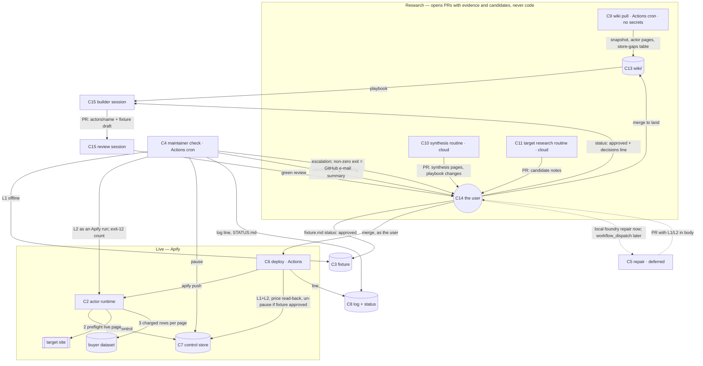

# Architecture — actor-foundry

Written 2026-10-18 by `/architect` from the frozen brief, the living plan and the rulings of the
same day; amended the same day after an independent Kun-lens review (ADRs 009–013, proposed).
Decisions live in `context/adr/`; this file holds the forces, the boundaries, the data shapes,
the failure modes, the verification posture and the handoff `blueprint` consumes. No
application code exists yet; the building happens in a separate session (user ruling).

## Forces

**Hard constraints**
- Every actor: pay-per-event, limited permissions, charged through `push_data`, state on
  `PERSIST_STATE`, open source, priced under the incumbent, never below platform cost.
- The maintainer never publishes, never changes a price, never touches another actor's
  fixture, never exceeds 1 compute unit per run; an actor it cannot repair is paused with a
  status message, never unpublished.
- No public listing without a dated ruling in `context/decisions.md` and a PR that passed an
  adversarial review in a non-authoring session (`/code-review high` with the candidate note,
  fixture and claimed checklist IDs as intent; `/red-team` before publish and on `.github/`
  or `routines/`).
- Secrets live in GitHub Actions repository secrets and the local `.env`, inventoried once in
  `.env.example`; never on the Grok Bot computer, never in a cloud routine. A plaintext `.env`
  posture is adequate while every secret is ours, cheap and revocable in a minute (vault
  `knowledge/when-plaintext-env-stops-being-adequate.md`).
- The only unattended runner is GitHub Actions cron; in-app scheduled tasks fire only while
  the app is open (vault, measured). GitHub documents that `schedule` runs can be delayed or
  dropped at the top of the hour. Cloud routines run memory-blind and load no `CLAUDE.md`.
- Unattended Claude Code on the subscription is documented for CI but limited; keep it rare.
- Apify scoped tokens cannot create or modify actors but can be limited to named resources
  (reviewer's read of the integrations docs, 2026-10-18; **assumed** until the first scoped
  token is created).
- The Store list envelope's `count` overstates the items it returns (`limit=1000` →
  `count: 1000`, 948 items; stable across repeated calls, 2026-10-18 — observed).
- The operator has 6–8 hours a week. Milestone 1 slips on 2026-11-15; the kill criterion is
  no paid run by a stranger by 2027-01-31.

**Scale.** Two actors by December; tens of buyer runs a day at first; one maintainer check per
actor per day; one wiki pull a week over ~91k Store actors (ranked locally); one synthesis a
month after two snapshots; at most two candidate notes per on-demand research run until actor
#1 is approved.

**Existing stack.** Python 3.12, `uv`, `pytest`, `ruff`, Apify Python SDK, Crawlee for
Python, Apify CLI, GitHub (private repo `wrighty321/actor-foundry`), Telegram bot, Obsidian on
`wiki/`, Claude Code (builder, reviewer, local repair), Claude cloud routines (synthesis, target
research). Bare `python` on this machine resolves to an unrelated venv — every command uses
`uv run`.

**Volatile vs stable** (the volatile parts get boundaries around them)
- Volatile: target-site markup (daily); the fetch layer per site (proxies, browser or not);
  Apify eligibility and pricing rules; model IDs and the Claude Code CLI surface; the
  synthesis and target-research prompts; the candidate scoring weights.
- Stable: the fixture format and pass definition (ADR 002, 009, 010); the control record
  schema (ADR 012); the charging contract (ADR 008, 009); the maintainer log line and status
  page (ADR 005, 013); the wiki's layout and evidence grades; the human gates.

## Components

| # | Component | Responsibility (one line) | Runs where | Writes | Reads | Secrets (see `.env.example`) |
|---|---|---|---|---|---|---|
| C1 | `foundry` package | Shared plumbing: control read/write, preflight, page-buffered charged push, fixture L1/L2 runner, Store client, store-gaps generator, Telegram sender, status page, CLI | library | — | — | — |
| C2 | Actor runtime `actors/<name>/src/` | Read control record → **preflight the fixture's live page** → input → fetch → `extract` → charged push per page; persist on `PERSIST_STATE`; fail loudly (exit 10 paused, 11 control unreadable, 12 preflight failed) | Apify | default dataset, KV state | control record, input, `live_pages[0]` | none (Apify injects the run token) |
| C3 | Fixture `actors/<name>/fixture/` | The user-owned definition of "working": saved sources, expected rows, anchors, `min_complete_share`, approval | data in repo | — | — | — |
| C4 | Maintainer check `maintainer-check.yml` → `foundry check` | Daily per actor: L1 offline, L2 as an Apify run of the deployed build, exit-12 count since last run; on fail pause and escalate; always one log line; regenerate `maintainer/STATUS.md`; candidate pings; Monday summary; **exit non-zero whenever a human is needed** | Actions cron, off the hour | control record, `maintainer/log/`, `maintainer/STATUS.md`, Telegram | fixture, runs list, candidate PRs | `APIFY_TOKEN_SCOPED`, Telegram pair |
| C5 | Maintainer repair | **Not built until the first real escalation** (ADR 013); until then `uv run foundry repair <actor>` runs the brief in the user's local Claude Code session. When built: `workflow_dispatch`, Claude Code, computes L1/L2 in-job into the PR body, sends the repair-request Telegram line, opens a PR; never deploys | local now; Actions later | a PR | repo, fixture result | later: `CLAUDE_CODE_OAUTH_TOKEN`, Telegram pair |
| C6 | Deploy `deploy.yml` → `foundry deploy` | On the **user's** push to `main` under `actors/**`: tests, vendor wheel, `apify push`, L1+L2 on the deployed build, price read-back against the README, un-pause only if `fixture.md` is `approved` on or after the repair, log | Actions on push, `if: github.actor == 'wrighty321'` | Apify build, control record, log | repo, `fixture.md`, `pricingInfos` | `APIFY_TOKEN`, Telegram pair |
| C7 | Control store `actor-foundry-control` | One record per actor: pause flag, reason, repair id (informational), last check | Apify named KV store | — | — | — |
| C8 | Maintainer log and status `maintainer/log/<actor>.md`, `maintainer/STATUS.md` | Append-only lines (the 7/30-day proof) and a regenerated one-page status: alive or dead, what awaits a human | repo | — | — | — |
| C9 | Wiki pull `wiki-pull.yml` → `foundry pull` | Weekly public Store pull: page, dedupe, reconcile on unique ids, snapshot, actor pages, weak sample, **generate `store-gaps.md`'s ranked table** | Actions cron | `wiki/evidence/**`, `wiki/synthesis/store-gaps.md` (table) | Store API (public), previous snapshot | none |
| C10 | Synthesis routine (`routines/wiki-synthesis.md`) | Monthly, after two snapshots: fill `wiki/synthesis/`, grade store-gaps rows, propose playbook changes — **all by pull request** | Claude cloud routine | PRs | snapshots, actor pages, first-party | none |
| C11 | Target research routine (`routines/target-research.md`) | On demand (cap 2) until actor #1 is approved, then weekly (cap 5): find, score and write candidate notes — **by pull request** | Claude cloud routine | PRs | `store-gaps.md`, the web | none |
| C12 | *(retired)* | Notifications merged into C4 (ADR 013); id kept so earlier references resolve | — | — | — | — |
| C13 | Wiki (Obsidian vault on `wiki/`) | Evidence → synthesis → playbook; candidates; first-party; the user's review surface | files | — | — | — |
| C14 | Human gates | Merge candidate PRs; set candidate `status`; set fixture `status`; merge repair PRs; publish ruling; `decisions.md` | the user | `wiki/candidates`, `fixture.md`, GitHub, `decisions.md` | Telegram, GitHub, Obsidian, `STATUS.md` | — |
| C15 | Builder and review sessions | Build from an approved note and fixture; review in a non-authoring session | Claude Code, interactive | `actors/<name>/**` by PR | `wiki/playbook/`, note (named sections only, B20), fixture | local `.env` only |

## Boundaries



Boundary test applied: a target site changing its markup touches `extract.py`, the fixture
(a new draft the user approves) and nothing else; a change to the pause semantics touches
`foundry.control` and the first lines of every `main.py` and nothing else; a prompt change
touches one file in `routines/` and nothing else; a change to who may deploy touches one
ruleset and one `if:` line.

## Interfaces and data shapes

**Control record** — `actor-foundry-control` KV store, key `<actor-name>` (ADR 012)
```json
{ "paused": false, "since": null, "reason": null, "repair_id": null,
  "last_check": "2026-11-02T06:23:00Z" }
```
`reason` is built only from fixture field names, anchor ids and HTTP codes (B21).

**Fixture** — `actors/<name>/fixture/fixture.md` frontmatter (ADR 002, 009, 010)
```yaml
status: draft            # draft | approved — set to approved only by the user, in their own commit
approved_on:             # YYYY-MM-DD; un-pause after a repair needs this ≥ the repair commit date
source_urls: [https://…/page-1, https://…/page-2]
fetched_on: 2026-11-01
live_pages: [https://…/page-1]      # live_pages[0] is also the in-actor preflight page
min_rows: 20
min_complete_share: 0.9             # a page below this share pushes nothing (ADR 009)
fields: [{name: company, type: str}, {name: title, type: str}, {name: url, type: url}]
anchors:
  - {id: company@1, field: company, kind: exact, value: "Acme Ltd", page: 1}
  - {id: url@1, field: url, kind: pattern, value: "^https://example\\.com/profile/\\d+$", page: 1}
  - {id: title@1, field: title, kind: present, page: 1}
```
`expected.jsonl`: one row per line, keys exactly `fields`, in extraction order. `source/`: one
saved response per `source_urls` entry, named by index. A repair that cannot pass L1 against
the approved sources ships a new draft of all three (ADR 010).

**Row** — the actor's output and the charged unit (ADR 008, 009): a flat JSON object whose keys
are exactly the fixture's `fields`. Rows are pushed per page through `foundry.charge.push_rows`
only when the page's complete-row share ≥ `min_complete_share`; incomplete rows are never
pushed.

**Exit codes** — 10 paused · 11 control store unreadable · 12 preflight failed. Each with a
status message that names the actor, the condition and "nothing was charged".

**Maintainer log line** — `maintainer/log/<actor>.md` (ADR 005)
```
2026-11-02 | L1 pass | L2 fail | anchors: company@1 | exit12: 3 | action: paused, escalated | CU 0.02 | run <url>
2026-11-03 | deploy a1b2c3d by wrighty321 | L1 pass | L2 pass | fixture: approved 2026-11-03 | action: unpaused | CU 0.03 | run <url>
```

**Status page** — `maintainer/STATUS.md`, regenerated by every check (ADR 013): a table per
actor (`last check`, `L1`, `L2`, `paused since`, `consecutive log days`, `exit12 last 24h`) and
a list — `last snapshot`, `candidate PRs awaiting merge`, `approved candidates awaiting their
decisions.md line`, `fixtures awaiting approval`. Any non-empty "awaiting" item or any fail
makes the check exit non-zero.

**Telegram messages** (plain text, send-only, all from C4 or C6; later also C5): escalation =
actor, structural cause (anchor ids, HTTP codes, exit-12 count), paused yes/no, how to run the
repair; repair request = actor, PR link, "L1 pass · L2 pass (run <url>)" computed in-job,
"Merge to deploy; close to reject"; candidate ping = one line per new PR: slug, pitch, total,
"merge to land, close to discard"; fixture request = "fixture needs your approval:
actors/<name>/fixture/fixture.md"; Monday summary = per actor: runs, repairs, escalations,
log-day count, profit (manual reading or "not read this week").

**Snapshot** — `wiki/evidence/snapshots/<date>.json` (ADR 007 as corrected)
```json
{ "pulled_at": "…", "pages": 92, "items_received": 87216, "unique_ids": 87216,
  "totals_seen": [90920, 90920], "previous_unique_ids": 86990,
  "sample": {"top300": [], "category_top20": {}, "weak": []},
  "actors": {"<id>": {}} }
```
The pull reconciles on `unique_ids` — against `min(totals_seen)` with a stated tolerance and
against `previous_unique_ids` with a named maximum drop — never on the envelope's `count`. A
pull that fails either test writes nothing and the job fails visibly. The committed test data
includes a page whose `count` exceeds its `items`.

**Store-gaps table** — generated by C9 from snapshot fields: actor, category, `notice`,
failed+timed-out share of 30-day runs, rating vs category median, 30-day users vs previous
snapshot. The prose grade column is filled by C10 (milestone 1d).

**Deploy gate grammar** (ADR 004 as amended): a PR touching `README.md`, `.actor/input_schema.json`
or `.actor/actor.json` pricing is labelled `listing-change` and needs a `decisions.md` line
dated on or before the merge that contains `#<PR number>`; the deploy step greps for exactly
that and fails with the missing line named. Deploy also `GET`s `pricingInfos` and compares the
`result` price with the README's per-1k line; a mismatch is a Telegram line, not a deploy
failure.

**Agent commit trailer** (ADR 011): `Agent: <routine or job>` and `Run: <url or id>` on every
agent-made commit; `git log --format='%(trailers)'` separates human from agent writes.

**`foundry` CLI** (ADR 006, 012, 013): `init` (create the control store), `check <actor>`,
`pause <actor> --reason`, `unpause <actor>`, `flag <actor>` / `unflag <actor>` (manual listing
prefix, unscoped token), `deploy <actor>`, `pull`, `repair <actor>` (local Claude Code brief),
`summary`. Every subcommand exits non-zero on any unverified write.

**Workflow triggers.** `maintainer-check`: cron `23 6 * * *`, iterating actors. `deploy`: push
to `main`, paths `actors/**`, job `if: github.actor == 'wrighty321'`. `wiki-pull`: cron weekly,
off the hour. `maintainer-repair`: not yet. Log and status commits touch `maintainer/**` only
and trigger nothing; they land through the Actions app's ruleset bypass.

## Failure modes and designed behaviour

| Component | Break | Designed behaviour |
|---|---|---|
| C2 actor | Control store unreadable | 3 retries with backoff, then `Actor.fail(exit_code=11, …)`; never run unchecked |
| C2 actor | Site changed structure (preflight) | `Actor.fail(exit_code=12, …)` naming the failed anchor ids; zero charges; the check counts exit-12 runs and escalates |
| C2 actor | A page extracts below `min_complete_share` | Nothing from that page is pushed; fail with the counts |
| C2 actor | Target blocks (403, challenge) | Fail with status "Blocked by target (HTTP 403) on <url>; nothing charged" |
| C2 actor | Buyer spending limit reached | `ChargeResult` seen → persist state, exit cleanly with the count |
| C2 actor | Migration mid-run | `PERSIST_STATE` handler saved progress; resume; no row charged twice |
| C2 actor | Preflight anchor moved but site fine | Runs blocked with the anchor named until the user updates the fixture — accepted |
| C4 check | Live fetch errors (network, 5xx) rather than mismatches | Retry twice; escalate as `fetch-error` **without pausing**; pause on content mismatch, or fetch-error two days running |
| C4 check | Pause write fails | 3 retries; then escalate "COULD NOT PAUSE <actor>"; exit non-zero |
| C4 check | Telegram send fails | Log line still written with `sent: false`; exit non-zero; GitHub e-mails |
| C4 check | Cron delayed or dropped | Off-hour schedule; STATUS.md shows the gap; the preflight means a late check no longer leaves wrong rows selling |
| C4 check | Scoped token cannot list runs | Exit-12 counting fails loudly; fallback is a second scoped token (ADR 012) |
| C4 check | Log/status commit rejected by the ruleset | Job fails visibly; fallback is a `maintainer-log` branch by a new ADR |
| C5 repair (local or later) | Claude Code exhausts turns or time | No PR; escalation stands; log line `repair failed` |
| C5 repair | Repaired parser cannot pass old L1 | PR ships a fixture draft; merge does not un-pause; Telegram asks for fixture approval |
| C6 deploy | Push actor is not the user | Job skipped; nothing deploys; STATUS.md lists the unexpected commit |
| C6 deploy | `apify push` fails | Previous build stays live; actor stays paused if it was; Telegram |
| C6 deploy | L2 fails on the deployed build, or fixture still `draft` | Stay paused; Telegram names the file to approve |
| C6 deploy | Listing-visible change without `#<PR>` ruling line | Deploy fails naming the missing line |
| C6 deploy | README price ≠ `pricingInfos` | Telegram mismatch line; the user corrects one side |
| C7 control store | Outage | Every actor fails closed; check escalates once per actor |
| C9 pull | Envelope `count` > items, `total` drift, page cap change | Reconcile on unique ids vs totals seen and vs previous snapshot; otherwise write nothing and fail |
| C10/C11 routines | Cannot reach the repo or open a PR | No output; fallback `/wiki-refresh` by hand; plan risk row carries it |
| C10/C11 routines | Misread prompt, write wrong pages | Arrives as a PR the user reads before merging; `wiki/playbook/` changes reviewed like `.github/`; planted-flaw check before trusting a routine |
| C13 wiki | Stale local copy | Obsidian Git with its base path set to the repo root pulls on open; never Obsidian Sync on `wiki/` |
| C14 gates | Note `approved` but no `decisions.md` line | B1 stops the build; STATUS.md lists it under "awaiting" until the next session records it |

## Verification posture

- **Test runner:** `uv run pytest` at the workspace root; `uv run ruff check` and `ruff format
  --check` beside it. Both run on every PR via Actions.
- **Tests with the user's authority (encode intent):** each actor's L1 — `extract(source/*)`
  must equal the user-approved `expected.jsonl`; the anchors in `fixture.md`; the planted-flaw
  sets for the routines (vault `knowledge/evaluate-llm-output-by-planting-known-flaws.md`): a
  committed test snapshot with known weak actors and one known gap must surface them, and a
  planted candidate set with one login-walled and one terms-flagged site must be excluded and
  flagged. These are the tests a failure can be trusted against.
- **Implementer tests (durable, committed, but a second copy of the implementer's reading):**
  `foundry.control` — call order recorded on a fake `Actor` proves the control read precedes
  any charge, retry count, fail-closed on exit 11; `foundry.charge` — zero `push_data` calls
  when the preflight fails or a page is below `min_complete_share`, the spending-limit path;
  `foundry.fixture` L2 assertions against saved responses stood in as "live";
  `foundry.store` — paging, dedupe, local ranking, and reconciliation against a saved page
  whose `count` exceeds its `items`; the store-gaps generator on a snapshot fixture; log-line
  formatting and parsing; STATUS.md and summary generation from a fixture log.
- **Held once on the private stub, not by tests** (recorded in `build-plan.md` with evidence):
  Docker context for the vendored wheel; kill-switch read before any charge; preflight exit 12
  on a deliberately broken live page; scoped token listing runs and writing the control store;
  synthetic-event double-charge check; `workflow_dispatch` runs of each workflow; the ruleset's
  Actions bypass letting a log commit through.
- **Third-party flows, one real run each:** Telegram delivery; merge → deploy → un-pause;
  cloud routine opening a PR; GitHub's failure e-mail on a non-zero check.
- **Cannot be held:** Store quality-score effects of paused failures, buyer behaviour, Actions
  minute usage before it is measured, GitHub mobile support for `workflow_dispatch`.

## Handoff for `blueprint`

**Components in dependency order**
1. C1 `foundry` package (control, charge with `push_rows`, fixture L1/L2 and preflight, store
   with reconciliation and store-gaps generator, telegram, status, cli) — everything else
   imports it.
2. C3 fixture format + C2 actor template (`actors/_template/`) with the control read and
   preflight as its first steps — the stub actor is the first instance.
3. C7 control store (`foundry init`), and the scoped token.
4. C4 maintainer check workflow + C8 log and STATUS.md (+ candidate ping and Monday summary).
5. C6 deploy workflow (actor guard, fixture-status un-pause gate, `#<PR>` listing gate, price
   read-back).
6. The ruleset on `main` with the Actions bypass (an operator step, recorded in the build plan).
7. C9 wiki pull with reconciliation and the store-gaps table.
8. C11 target research routine + `routines/target-research.md`, on demand (milestone 1c).
9. C10 synthesis routine + `routines/wiki-synthesis.md` + `/wiki-refresh` skill (milestone 1d).
10. C5 repair workflow — after the first real escalation; `foundry repair` (local) ships with C1.

**ADRs:** 001 runner topology · 002 fixture semantics · 003 pause (superseded by 012) · 004
approval and deployment · 005 maintainer state and log · 006 repo layout · 007 research-agent
runners · 008 pricing events · 009 in-actor preflight and page-buffered charging · 010 repair,
fixture re-approval and un-pause gate · 011 branch rules and deploy guard · 012 pause as kill
switch only with a scoped token · 013 sequencing. 001–008 accepted by the user on 2026-10-18
(003 since superseded); 009–013 proposed by the Kun pass of the same day and accepted by the user
the same day. A reversal of any of them is a new ADR marked `Supersedes NNN`, never an edit.

**Failure modes and verification:** the two sections above, as written.

**Open questions the design leaves on purpose**
- Whether a buyer can be spared the $0.00005 start fee on a paused attempt — platform-charged;
  accepted unless a cheaper honest route appears.
- The Docker build context for `apify push` (assumed the actor directory) — verified on the
  stub.
- Whether a scoped token can list runs and write one KV store as the docs describe — verified
  when the token is created.
- Whether this repo's plan offers push rulesets with file-path restriction (would replace the
  Actions bypass) — checked when the ruleset is created.
- Whether cloud routines can open PRs against the private repo — verified by 1c's first run.
- Whether the Obsidian Git plugin accepts a base path one level above the vault — verified at 1b.
- A failure-class taxonomy for the trust ladder — written from the first real escalations.
- Profit per actor stays a manual weekly reading until an analytics API is found.
- Whether to retire C7 if, over milestone 4, every pause came from a preflight the actor
  already enforces (would supersede ADR 012) — decided on that evidence.
